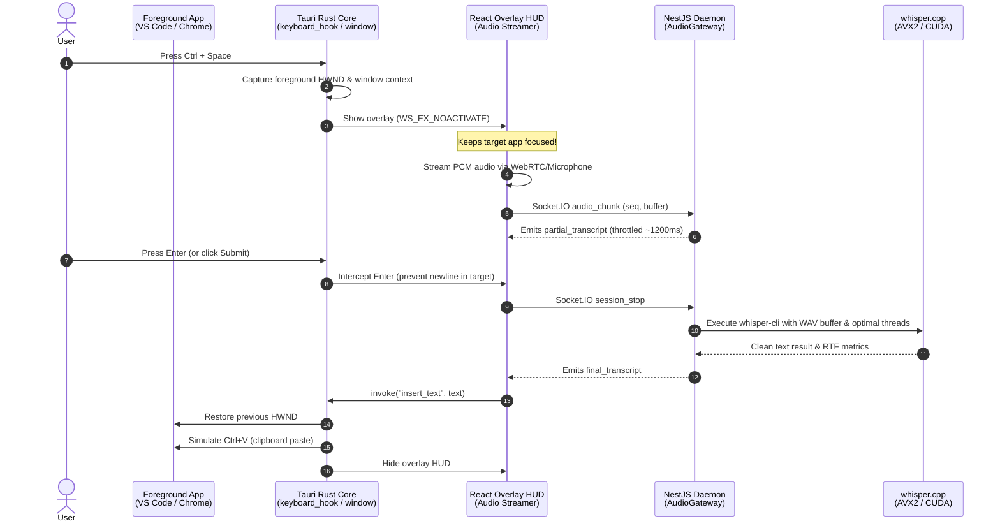

<p align="center">
  
</p>

<h1 align="center">VoiceFlow</h1>

<p align="center">
  <strong>Type at the speed of thought. 100% offline, private AI voice dictation for Windows and macOS.</strong>
</p>

<p align="center">
  <a href="https://github.com/Utpal4505/voiceflow-releases/releases/latest"></a>
  <a href="https://github.com/Utpal4505/voiceflow-releases/releases"></a>
  <a href="https://github.com/Utpal4505/voiceflow/blob/main/LICENSE"></a>
  <a href="https://github.com/ggerganov/whisper.cpp"></a>
  <a href="https://tauri.app"></a>
  <a href="https://turbo.build"></a>
  <a href="https://nestjs.com"></a>
  <a href="https://react.dev"></a>
</p>

<p align="center">
  <a href="#-quick-download">Quick Download</a> •
  <a href="#-key-features">Key Features</a> •
  <a href="#-system-architecture">Architecture</a> •
  <a href="#-comparison-voiceflow-vs-cloud-saas">Comparison</a> •
  <a href="#-whisper-model-catalog">Models</a> •
  <a href="#-developer-setup--monorepo-guide">Developer Setup</a> •
  <a href="#-privacy--telemetry">Privacy</a>
</p>

---

## 💡 Overview

**VoiceFlow** is a blazingly fast, system-wide speech-to-text dictation application built natively for **Windows 10 and 11**. Press <kbd>Ctrl</kbd> + <kbd>Space</kbd> anywhere—inside **VS Code**, **Cursor**, **Slack**, **Notepad**, **Chrome**, **Word**, or **Windows Terminal**—and dictate seamlessly.

Unlike cloud-dependent dictation services that charge \$15–\$30/month and beam your private voice recordings to external servers, VoiceFlow runs **entirely offline** on your machine. Powered by high-performance C++ vector-accelerated [whisper.cpp](https://github.com/ggerganov/whisper.cpp) with AVX2/CUDA optimization, **zero bytes of audio ever leave your computer**.

```
  [You Speak] 🎙️
       │
       ▼  (Ctrl + Space anywhere)
 ┌──────────────────────────────────────────────────────────────────┐
 │  VoiceFlow Floating HUD (WS_EX_NOACTIVATE — Keeps Focus)         │
 └──────────────────────────────────────────────────────────────────┘
       │
       ▼  (Real-Time Streaming over Local WebSockets)
 ┌──────────────────────────────────────────────────────────────────┐
 │  Local Whisper.cpp Engine (Hardware-Tuned AVX2 / CUDA)          │
 └──────────────────────────────────────────────────────────────────┘
       │
       ▼  (Press Enter)
 ┌──────────────────────────────────────────────────────────────────┐
 │  Direct Keystroke / Paste into Active Window (VS Code, Slack...) │
 └──────────────────────────────────────────────────────────────────┘
```

---

## 🚀 Quick Download

Ready to run VoiceFlow immediately? Grab the latest release for your platform:

| Package | Format | Platform | Description |
| :--- | :--- | :--- | :--- |
| **[VoiceFlow for Mac (Apple Silicon)](https://github.com/Utpal4505/voiceflow-releases/releases/latest/download/VoiceFlow.dmg)** | `.dmg` | macOS (M1/M2/M3/M4) | **Recommended for Mac.** Hardware Metal GPU acceleration. |
| **[VoiceFlow Installer](https://github.com/Utpal4505/voiceflow-releases/releases/latest/download/VoiceFlow-Setup.exe)** | `.exe` (NSIS) | Windows 10/11 | **Recommended for Windows.** Installer with auto-updater. |
| **[VoiceFlow Portable](https://github.com/Utpal4505/voiceflow-releases/releases/latest/download/VoiceFlow_0.2.5_x64-setup.zip)** | `.zip` | Windows 10/11 | Portable archive. Extract and run anywhere without admin rights. |

> [!NOTE]
> **Windows SmartScreen Note**: Because VoiceFlow is an indie open-source application and has not purchased a \$500/yr enterprise EV code signing certificate, Windows Defender SmartScreen may show an _"Unrecognized app"_ prompt on first launch. Click **"More info"** &rarr; **"Run anyway"**. VoiceFlow binaries are 100% open-source, reproducible, and verifiable.

---

## ✨ Key Features

### 🎯 System-Wide Global Hotkey (`Ctrl + Space`)

A low-level Windows keyboard hook (`WH_KEYBOARD_LL`) running at time-critical scheduling priority captures your hotkey globally across the entire operating system, instantly summoning the dictation HUD.

### 🪟 Non-Activating Translucent HUD (`WS_EX_NOACTIVATE`)

Engineered with Win32 `WS_EX_NOACTIVATE` and `SW_SHOWNOACTIVATE`. When the floating HUD appears, your active editor, IDE, or chat box **never loses keyboard focus**. You see an animated voice-reactive waveform and live partial transcription without window blinking or focus hopping.

### ⚡ Direct Foreground Keystroke & Clipboard Paste

- **Press <kbd>Enter</kbd>**: Dictation stops, audio finishes transcription, and text is automatically simulated into your active cursor position via Win32 `keybd_event` paste simulation.
- **Press <kbd>Escape</kbd>**: Immediately aborts the session, discards audio buffers, and hides the overlay.

### 🛡️ 100% Offline & Air-Gapped Privacy

- **Zero Cloud Egress**: All inference runs locally in RAM via OpenAI Whisper.
- Works in complete **Airplane Mode** without an internet connection.
- Ideal for software engineers handling proprietary codebases, doctors dealing with HIPAA-regulated records, lawyers, and writers under NDAs.

### 🧠 Hardware Profiling & Vector Acceleration

- Automatically detects CPU instruction sets (**AVX2, AVX, FMA, SSE4.2**) and optimal thread counts.
- Dynamically uses discrete **NVIDIA CUDA** acceleration when available, without prematurely waking mobile GPUs from D3Cold sleep (preventing battery drain and stutter).
- Runs 3x faster than real-time speech on modern Intel Core and AMD Ryzen CPUs.

### 📦 Self-Contained Zero-Dependency Runtime

Includes portable binaries for `whisper-cli.exe`, platform DLLs, and an embedded Node server runtime. **You do not need to install Node.js, Python, CUDA Toolkit, or Git** to use the application.

### 📚 In-App Whisper Model Manager

Download, switch, and delete quantized Whisper GGML models directly from the UI with real-time download progress meters. Start with the lightning-fast `base.en-q5_0` (~85 MB) or scale up to `small.en` and `medium.en` for high-precision technical vocabulary.

### 📖 Custom Technical Vocabulary

Inject custom technical acronyms, programming symbols, internal project codenames, or jargon into Whisper's initial prompt bias (e.g. `Kubernetes`, `GraphQL`, `OAuth2`, `Zod`, `Tauri`, `PostHog`).

### 📜 Searchable Local History & Performance Metrics

View your past dictations, search by keyword, copy text with one click, and inspect real-time metrics including word count, latency (ms), and **Real-Time Factor (RTF)** benchmarks.

### 🔄 System Tray & Windows Autostart

Closes silently to the Windows System Tray with quick controls. Enable "Launch on Windows Startup" to register with the Windows Registry (`HKEY_CURRENT_USER\Software\Microsoft\Windows\CurrentVersion\Run`) for seamless, instant boot-to-dictate capability with ~80 MB idle RAM footprint.

### 🔐 Cryptographic Auto-Updater

Tauri auto-updater secured with **Minisign public-key cryptography**. Securely updates directly from GitHub Releases without third-party intermediaries.

---

## 🏗️ System Architecture

VoiceFlow is organized as a high-performance monorepo powered by **Turborepo** and **pnpm**:

```
voiceflow/
├── apps/
│   ├── desktop/         # Tauri v2 native desktop application (Rust + React 19 + Vite)
│   ├── api/             # Embedded background API daemon (NestJS + WebSockets + Whisper CLI)
│   └── web/             # Next.js product landing page, interactive demo & docs
├── packages/
│   └── contracts/       # Shared TypeScript Zod schemas & WebSocket event contracts
├── bin/                 # Precompiled whisper.cpp binaries, dynamic CPU DLLs & Node runtime
├── release/             # Staged distribution installers & update signatures
└── scripts/             # Release & cryptographic signing automation
```

### End-to-End Dictation Pipeline



---

## ⚖️ Comparison: VoiceFlow vs. Cloud SaaS

| Feature                 |                         VoiceFlow                          | Cloud Dictation (Wispr Flow / Otter / Dragon) |
| :---------------------- | :--------------------------------------------------------: | :-------------------------------------------: |
| **Pricing**             |             **100% Free & Open Source (MIT)**              |       \$12 – \$30 / month subscription        |
| **Audio Privacy**       |            **100% Local (Never leaves device)**            |       Streamed to remote cloud servers        |
| **Works Offline**       |              **Yes (Works in Airplane Mode)**              |           No (Fails without Wi-Fi)            |
| **System-Wide Hotkey**  | **<kbd>Ctrl</kbd> + <kbd>Space</kbd> anywhere on Windows** |   Often limited to web or proprietary apps    |
| **Target App Focus**    |             **Preserved (`WS_EX_NOACTIVATE`)**             |       Often steals active window focus        |
| **Data Retention**      |              **Zero audio cached or logged**               |   Transcripts stored & used for AI training   |
| **Engine Transparency** |             **OpenAI Whisper (Auditable C++)**             |       Proprietary black-box cloud APIs        |
| **Startup Footprint**   |                **~80 MB idle RAM in Tray**                 |      High RAM browser wrappers & daemons      |

---

## 📊 Whisper Model Catalog

VoiceFlow ships ready to download any official GGML Whisper model with single-click installation:

| Model ID        | Quantization         | Disk Size | Speed          |  Accuracy  | Memory (RAM) | Recommended Hardware                  |
| :-------------- | :------------------- | :-------- | :------------- | :--------: | :----------- | :------------------------------------ |
| `tiny.en`       | F16                  | 75 MB     | ⚡ Instant     |    ⭐⭐    | ~300 MB      | Any CPU / Laptops                     |
| `base.en-q5_0`  | **Q5_0 (Quantized)** | **85 MB** | ⚡ **Instant** |   ⭐⭐⭐   | **~350 MB**  | **Default recommended for all PCs**   |
| `base.en`       | F16                  | 140 MB    | 🚀 Very Fast   |   ⭐⭐⭐   | ~500 MB      | Modern Quad-Core CPU or GPU           |
| `small.en-q5_1` | Q5_1 (Quantized)     | 185 MB    | 🚀 Fast        |  ⭐⭐⭐⭐  | ~700 MB      | 6+ Core CPU or CUDA GPU               |
| `small.en`      | F16                  | 460 MB    | ⏱️ Fast        |  ⭐⭐⭐⭐  | ~1.0 GB      | Modern Multi-core CPU / Dedicated GPU |
| `medium.en`     | F16                  | 1.5 GB    | ⏳ Moderate    | ⭐⭐⭐⭐⭐ | ~2.5 GB      | High-end 8+ Core CPU or NVIDIA RTX    |
| `large-v3`      | F16                  | 3.1 GB    | 🐢 Slow        | ⭐⭐⭐⭐⭐ | ~4.5 GB      | High-end NVIDIA GPU (CUDA)            |

---

## ⌨️ Global Shortcuts & Controls

| Shortcut / Action                  | Scope                | Description                                                                          |
| :--------------------------------- | :------------------- | :----------------------------------------------------------------------------------- |
| <kbd>Ctrl</kbd> + <kbd>Space</kbd> | **Global (Windows)** | Summon VoiceFlow floating HUD and immediately start dictating.                       |
| <kbd>Enter</kbd>                   | **Overlay Active**   | Finish dictation, transcribe audio, and paste text directly into active application. |
| <kbd>Escape</kbd>                  | **Overlay Active**   | Cancel current dictation, discard audio, and restore window focus.                   |
| **Close (`X`) on Window**          | **Main App**         | Minimizes cleanly to the Windows System Tray instead of terminating the app.         |
| **Tray Icon Click**                | **System Tray**      | Toggle VoiceFlow Dashboard between visible and minimized.                            |

---

## 💻 Developer Setup & Monorepo Guide

### 🛠️ Prerequisites

- **Operating System**: Windows 10/11 x64
- **Node.js**: `v20.0.0` or higher ([nodejs.org](https://nodejs.org))
- **Package Manager**: `pnpm` v9 or higher (`npm install -g pnpm`)
- **Rust Toolchain**: Stable MSVC toolchain (`rustup default stable-x86_64-pc-windows-msvc`)
- **Visual Studio Build Tools**: C++ build tools and Windows 10/11 SDK installed

### 1. Clone & Install Dependencies

```powershell
# Clone the repository
git clone https://github.com/Utpal4505/voiceflow.git
cd voiceflow

# Install dependencies across all monorepo packages
pnpm install
```

### 2. Run in Development Mode

You can run individual services or the entire system concurrently:

```powershell
# Run the complete monorepo concurrently (Desktop + API + Web)
pnpm dev

# Or run the Desktop + API pair (recommended for desktop app development):
pnpm start

# Run individual packages:
pnpm desktop    # Launches Vite dev server for desktop frontend
pnpm api        # Launches NestJS API server in watch mode
pnpm web        # Launches Next.js landing site on http://localhost:3000
```

### 3. Build & Package Desktop Application

Compile all TypeScript packages, build the NestJS server bundle, and package the signed NSIS Windows installer:

```powershell
# Build all packages in monorepo
pnpm build

# Build the desktop Tauri bundle (outputs to apps/desktop/src-tauri/target/release/bundle/nsis/)
pnpm package

# Build with debug symbols
pnpm package:debug
```

### 4. Create a Cryptographically Signed Release

VoiceFlow includes an automated release script that builds, signs, and stages release artifacts in the `release/` directory:

```powershell
# Generate signed NSIS installer, updater zip, and latest.json
pnpm release

# Open the release folder in Windows Explorer
pnpm release:open
```

---

## 📂 Project Structure

```
voiceflow/
├── apps/
│   ├── desktop/                       # Native Tauri v2 Application
│   │   ├── src/                       # React 19 Frontend
│   │   │   ├── components/            # AudioStudio, ModelManager, HistoryView, Settings
│   │   │   ├── hooks/                 # useAudio, useWebSocket (Socket.IO client)
│   │   │   ├── windows/               # MainWindow.tsx, OverlayWindow.tsx
│   │   │   └── stores/                # Zustand stores (history, settings, vocabulary)
│   │   └── src-tauri/                 # Rust Core
│   │       └── src/
│   │           ├── keyboard_hook.rs   # Low-level Windows hook (WH_KEYBOARD_LL)
│   │           ├── insertion.rs       # Win32 keybd_event paste simulation
│   │           ├── context.rs         # Active window & process inspection
│   │           ├── autostart.rs       # Windows Registry startup integration
│   │           ├── server_manager.rs  # Embedded Node/NestJS process lifecycle
│   │           ├── tray.rs            # Windows System Tray menu & events
│   │           └── lib.rs             # Tauri command invocations & window config
│   │
│   ├── api/                           # NestJS Background Server
│   │   └── src/
│   │       ├── audio/                 # Socket.IO Gateway for streaming PCM chunks
│   │       ├── transcription/         # Whisper.cpp CLI adapter & hardware profiler
│   │       ├── models/                # Hugging Face GGML model downloader & manager
│   │       └── session/               # Active dictation session lifecycle & watchdog
│   │
│   └── web/                           # Next.js 15 Landing & Showcase Site
│       ├── app/                       # App Router (page.tsx, layout.tsx)
│       └── components/                # Hero, Features, Comparison, InteractiveDemo
│
├── packages/
│   └── contracts/                     # Shared TypeScript Contracts & Zod Schemas
│       └── src/                       # audio.ts, models.ts, session.ts, settings.ts
│
├── bin/                               # Precompiled binaries (whisper-cli, node, ggml DLLs)
├── scripts/                           # Release packaging scripts (release.mjs)
├── turbo.json                         # Turborepo task pipeline configuration
└── package.json                       # Monorepo workspaces definition
```

---

## 🔒 Privacy & Telemetry Guarantee

VoiceFlow was created specifically to escape telemetry-heavy, privacy-invasive cloud dictation SaaS.

- **Audio Recordings**: **NEVER recorded, saved to disk, or sent over any network.**
- **Transcribed Text**: Processed entirely in RAM, pasted into your target window, and stored only in your local browser `localStorage` history log.
- **Anonymous Performance Telemetry**: VoiceFlow includes an optional, privacy-preserving telemetry client (PostHog) that records only anonymized metadata:
  - Total latency and Real-Time Factor (RTF)
  - Selected model ID and hardware tier (CPU vs CUDA)
  - General crash reports
  - _Strictly disabled_: Screen recordings, audio captures, text contents, IP addresses, and DOM click tracking are **permanently disabled**.
- **1-Click Opt-Out**: Open **Settings &rarr; General** and toggle off _"Help improve VoiceFlow by sending anonymous performance metrics"_.

---

## 🗺️ Roadmap

- [x] Global Windows hotkey (`Ctrl + Space`) with `WS_EX_NOACTIVATE` HUD overlay
- [x] Instant simulated paste insertion via Win32 API
- [x] Local Whisper.cpp inference with AVX2 & CUDA acceleration
- [x] One-click in-app model downloader & manager
- [x] Custom vocabulary injection & technical prompt biasing
- [x] Windows Registry autostart & System Tray minimization
- [x] Cryptographic Minisign auto-updater
- [ ] Multi-language transcription & auto-translation
- [ ] Push-to-Talk (hold hotkey to talk, release to insert) mode
- [ ] Custom punctuation replacement rules & snippet expansion
- [ ] macOS (Metal) & Linux (ALSA/PulseAudio) cross-platform ports

---

## 🤝 Contributing

Contributions, feature requests, and bug reports are welcome!

1. **Fork the Project**
2. **Create your Feature Branch** (`git checkout -b feature/AmazingFeature`)
3. **Commit your Changes** (`git commit -m 'feat: add amazing feature'`)
4. **Push to the Branch** (`git push origin feature/AmazingFeature`)
5. **Open a Pull Request**

Please review our code formatting rules before opening a PR (`pnpm lint` and `cargo fmt`).

---

## 📄 License

Distributed under the **MIT License**. See [`LICENSE`](./LICENSE) for more information.

---

<p align="center">
  Crafted with care by <a href="https://github.com/Utpal4505">Utpal4505</a> and open-source contributors.
</p>
